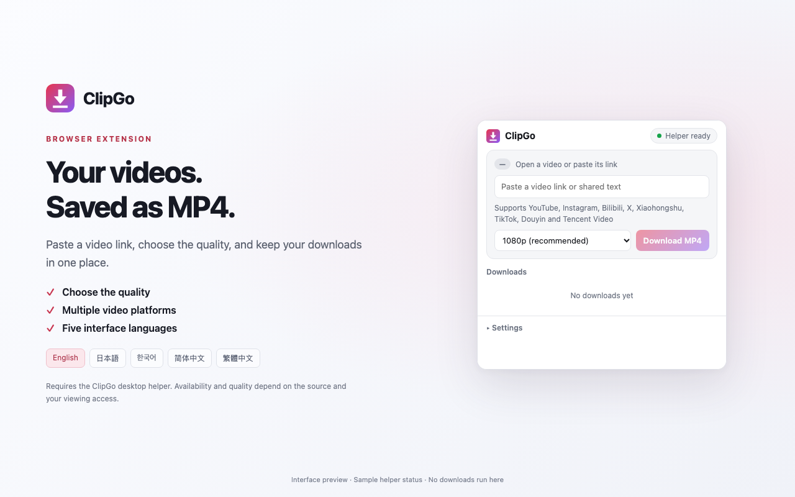
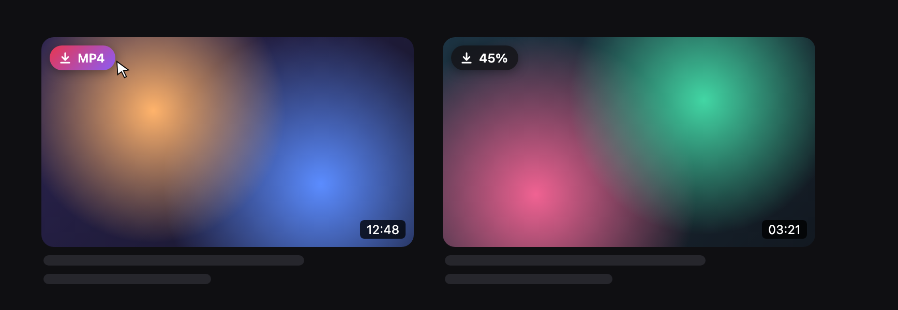
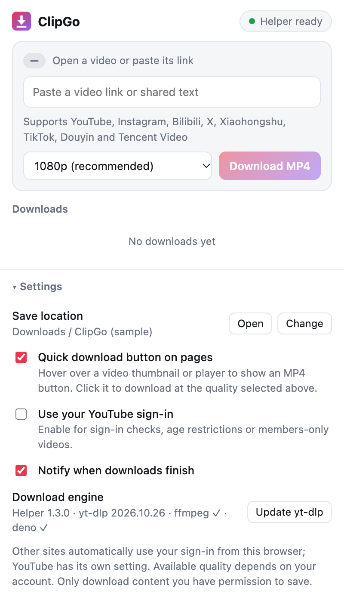

<div align="center">


# ClipGo

**A browser extension that saves online videos as MP4 in one click**

Works with YouTube · Instagram · Bilibili · X (Twitter) · Xiaohongshu · TikTok · Douyin · Tencent Video

Microsoft Edge / Google Chrome · Windows 10/11 · macOS

[简体中文](README.md) | **English**

[Download for Windows](https://github.com/Wonvy/ClipGo/releases/latest) · [Support page](https://wonvy.github.io/ClipGo/) · [Report an issue](https://github.com/Wonvy/ClipGo/issues) · [Developer docs (Chinese)](docs/DEVELOPMENT.md)

</div>

<p align="center">
  
</p>

> [!NOTE]
> Only download content you are authorized to save. ClipGo does not bypass DRM or access restrictions. Available quality depends on the source and on your account's viewing access.

---

## Highlights

- **One-click downloads**: hover over a video thumbnail or player and click the "⬇ MP4" button in its top-left corner. The button hides automatically while you watch fullscreen
- **Plays everywhere**: 1080p H.264 + AAC by default, so any player, phone or editor can open it. Up to 4K is available
- **Eight platforms**: YouTube (incl. Shorts), Instagram (Reels / posts / stories), Bilibili (BV / av / b23.tv / multi-part), X, Xiaohongshu, TikTok, Douyin, Tencent Video
- **Task management**: live progress, cancel, retry, show in folder, and a system notification when done
- **Uses your existing sign-in**: automatically reuses each site's sign-in from this browser, no cookie export needed (YouTube is opt-in in Settings)
- **Five interface languages**: English, 简体中文, 繁體中文, 日本語, 한국어, following your browser language

<table>
  <tr>
    <td width="60%" valign="top">
      <b>Quick download button on pages</b><br>
      <sub>Hover over a thumbnail to download; the button shows progress (illustration)</sub><br><br>
      
    </td>
    <td width="40%" valign="top">
      <b>Extension popup</b><br>
      <sub>Paste a link, choose quality, manage tasks and settings</sub><br><br>
      
    </td>
  </tr>
</table>

---

## Contents

- [How it works](#how-it-works)
- [Installation](#installation)
- [Usage](#usage)
- [Supported sites and links](#supported-sites-and-links)
- [Settings](#settings)
- [Quality options](#quality-options)
- [FAQ](#faq)
- [Updating and uninstalling](#updating-and-uninstalling)
- [WeChat Channels tool (Windows)](#wechat-channels-tool-windows)
- [Project structure](#project-structure)
- [Acknowledgements](#acknowledgements)

---

## How it works

```
┌────────── Browser (Edge / Chrome) ──────────┐          ┌────────── Local: ClipGo helper ──────────┐
│                                             │  Native  │                                          │
│  "MP4" page button ─┐                       │ Messaging│  clipgo_host.py                          │
│  Context menu ──────┼─► background.js ──────┼──────────┼─► yt-dlp  downloads video and audio      │
│  Popup ─────────────┘   task list/progress  │          │   ffmpeg  merges into MP4                │
│                                             │          │   deno    handles YouTube JS challenges  │
└─────────────────────────────────────────────┘          └──────────────────────────────────────────┘
```

High-quality video on YouTube and similar sites is delivered as separate, signed audio and video streams, which a browser extension alone cannot download reliably. ClipGo is therefore split into two parts:

| Part | Role |
|---|---|
| **Browser extension** (`extension/`) | UI: page buttons, context menu, popup, task list |
| **Local helper** (`host/`) | Does the downloading with [yt-dlp](https://github.com/yt-dlp/yt-dlp) and merges into MP4 with FFmpeg |

They talk over the browser's [Native Messaging](https://developer.chrome.com/docs/extensions/develop/concepts/native-messaging). The helper does not run in the background; the browser starts it only when needed.

---

## Installation

### Windows: offline installer (recommended)

1. Download `ClipGo-1.3.0-Windows-x64-Setup.exe` from [Releases](https://github.com/Wonvy/ClipGo/releases/latest). If you installed the extension from the Chrome or Edge store, download `ClipGo-1.3.0-Chrome-Edge-Windows-x64-Setup.exe` instead
2. Run it, pick a language and install. Python, yt-dlp, FFmpeg, FFprobe and Deno are bundled: **no admin rights and no extra downloads needed**
3. When setup finishes, the Setup Guide opens. Follow it to turn on Developer mode in Chrome or Edge and load the extension folder
4. Open ClipGo. When **"● Helper ready"** appears in the top-right, you're done. Refresh any video pages that were already open

- Installed to `%LOCALAPPDATA%\ClipGo`; keep this folder
- Reopen the guide anytime from **ClipGo Setup Guide** in the Start menu
- The installer is currently unsigned; verify it with the SHA-256 on the Releases page

### macOS

Open Terminal and run (adjust the path to where you put ClipGo):

```bash
bash ~/Downloads/ClipGo/host/install-mac.sh
```

- Installs to `~/Library/Application Support/ClipGo` and downloads about 150 MB of components (yt-dlp, FFmpeg, Deno)
- Uses the system Python 3; if it's missing, run `xcode-select --install` first
- Supports Apple silicon (arm64) and Intel (x86_64)

Then [load the browser extension](#load-the-browser-extension).

### From source (Windows / macOS)

```bash
git clone https://github.com/Wonvy/ClipGo.git
```

Then install the local helper:

- **Windows**: double-click `host\install-windows.bat` and close the window when it says it's done. It bundles a private embedded Python that doesn't touch your system
- **macOS**: run `bash host/install-mac.sh`

#### Load the browser extension

1. Open the extensions page: `edge://extensions` in Edge or `chrome://extensions` in Chrome
2. Turn on **Developer mode** (left sidebar in Edge, top-right in Chrome)
3. Click **Load unpacked** and choose the **`extension`** folder inside ClipGo
4. Check that the extension ID is `mnhnajpalaecohikjibocdeamfmnpena`
5. Click the puzzle icon in the toolbar and pin ClipGo

> [!TIP]
> The extension ID is fixed by the `key` in `manifest.json`, so it is the same on every computer and browser. The helper only accepts connections from this ID (and the store edition IDs).

<details>
<summary>Build the Windows installer yourself</summary>

```powershell
powershell -ExecutionPolicy Bypass -File packaging/windows/build.ps1
```

- Requires [NSIS](https://nsis.sourceforge.io/); runtime versions and SHA256 hashes are pinned in `packaging/windows/runtime-lock.json`
- Output goes to `dist/` and contains no local settings, cookies or download history
- Add `-LocalSetup` to build `ClipGo-1.3.0-Local-Windows-x64-Setup.exe` without overwriting the store-companion helper installer

</details>

---

## Usage

### Option 1: the quick download button on pages

Hover over a video **thumbnail** or a **playing player** and an **"⬇ MP4"** button appears in its top-left corner. Click it to download at your default quality. The button is hidden while a video is fullscreen.

| Button shows | Meaning |
|---|---|
| `⬇ MP4` | Click to download |
| `Starting…` → `✓ Started` | Handed off to the helper |
| `45%` / `Merging…` | This video is downloading |
| `Saved · Download again` | Already downloaded; click to download again |
| `Failed` + message at the bottom | See the message for the reason |

### Option 2: the popup

1. On a video page, click the ClipGo icon in the toolbar; the link is filled in automatically. You can also paste a video link or share text that contains one
2. Choose a quality and click **"Download MP4"**
3. The **Downloads** list shows progress, with **Cancel**, **Retry** and **Show in folder**

### Option 3: the context menu

- Right-click a video **link** → "Download this video with ClipGo (MP4)" (on Instagram feeds, right-click the post's timestamp)
- Right-click a video **page** → "Download the current video with ClipGo (MP4)"

### Where files are saved

By default to **`Downloads/ClipGo`** (`~/Downloads/ClipGo`), named `Video title [video ID].mp4`. You can change this in Settings.

---

## Supported sites and links

| Site | Supported links and scope |
|---|---|
| YouTube | Home, search, channels, recommendations, Shorts, watch page, hover previews |
| Instagram | Feed video posts, profile grids, Reels, stories |
| Bilibili | `bilibili.com/video/BV…`, `/video/av…` (incl. mobile), `b23.tv` short links. Multi-part videos keep `?p=2` etc. and download only that part. Anime, live streams and batch collection downloads are not supported |
| X (Twitter) | `x.com/user/status/ID` and the matching `twitter.com` links; attachment indexes like `/video/2` are kept |
| Xiaohongshu | `/explore/noteID`, `/discovery/item/noteID`, `xhslink.com` short links. Keep the full share link including `xsec_token`. Image notes are not videos |
| TikTok | `/@user/video/ID`, `vm.tiktok.com`, `vt.tiktok.com`, `tiktok.com/t/code`. Profiles, collections and live streams are not downloaded |
| Douyin | `/video/ID`, the page's `modal_id`, `v.douyin.com` short links. Whole feeds and live streams are not downloaded |
| Tencent Video | `v.qq.com/x/page/ID.html`, `/x/cover/albumID/videoID.html`. Single videos or episodes only |

<details>
<summary>How Douyin media is resolved</summary>

When you paste a Douyin `/video/ID` link or retry an old task, you don't need to start playback first. If no page media info is available, the extension opens the video in a muted background tab, without a popup window and without leaving your current tab, waits up to about 12 seconds for the playback URL and then closes it. If you take over that tab or navigate elsewhere, the extension leaves it open. Task history stores only the page link, never the temporary media URL. You can cancel at any time while it's "Preparing".

</details>

---

## Settings

Open the ClipGo popup and expand **Settings** at the bottom:

| Setting | Description | Default |
|---|---|---|
| Save location | "Change" opens the system folder picker | `Downloads/ClipGo` |
| Quick download button on pages | Show the "MP4" button on thumbnails and players | On |
| Use your YouTube sign-in | For age-restricted or members-only videos, or "confirm you're not a bot" prompts | Off |
| Notify when downloads finish | Shows a system notification; click it to reveal the file | On |
| Update yt-dlp | Use this when a site change breaks downloads | — |

The quality chosen in the popup is remembered and also used by the page button and the context menu.

---

## Quality options

| Option | Codec | Notes |
|---|---|---|
| **1080p (recommended, default)** | H.264 + AAC | Best compatibility: QuickTime, Windows players, phones, CapCut and Premiere open it directly |
| Best (4K) | AV1 / VP9 + AAC | Up to 4K/8K. Older computers and QuickTime may not play it; use VLC or a browser |
| 720p / 480p / 360p | H.264 + AAC | Smaller files |

If a video doesn't reach the selected resolution, the best available quality is downloaded. Instagram usually offers a single quality. On Bilibili and similar sites, quality depends on your account; choosing a higher option does not grant access your account doesn't have.

---

## FAQ

<details>
<summary><b>"Helper disconnected" / "Not installed"</b></summary>

The helper isn't installed, or the extension wasn't reloaded after installing. Run the installer again, then click ClipGo's reload button on the extensions page.
</details>

<details>
<summary><b>"The helper rejected this extension because its ID does not match"</b></summary>

The extension ID isn't `mnhnajpalaecohikjibocdeamfmnpena`. Make sure the `key` field in `manifest.json` hasn't been removed or changed.
</details>

<details>
<summary><b>Sign-in required (Instagram / Bilibili / X / Xiaohongshu / TikTok / Douyin)</b></summary>

Sign in to the site in the **same browser**, check that your account can play the video, then retry. ClipGo hands the site's sign-in cookies to the helper in a temporary file that is deleted as soon as the download ends. For Xiaohongshu, copy the full share link again. If requests are rate-limited (e.g. Bilibili 412 / 429), wait a moment and retry.
</details>

<details>
<summary><b>Tencent Video says you don't have access, or the video is protected</b></summary>

Make sure your account can play the video. ClipGo checks whether the returned video is only a preview clip and reports an error rather than saving an incomplete file. DRM and unknown encryption methods are not supported, and signing in doesn't guarantee every members-only video can be downloaded.
</details>

<details>
<summary><b>YouTube says "Sign in to confirm you're not a bot", or everything suddenly fails</b></summary>

- Sign in to YouTube in the same browser and turn on **"Use your YouTube sign-in"** in Settings
- If everything fails, YouTube probably changed something: click **"Update yt-dlp"** in Settings
</details>

<details>
<summary><b>The "MP4" button doesn't appear</b></summary>

- After the extension updates or reloads, **refresh** pages that were already open
- Check that **"Quick download button on pages"** is on in Settings
- The button only appears on large enough thumbnails (100px+ wide) and players, and hides while fullscreen
</details>

<details>
<summary><b>Downloads are slow or time out</b></summary>

The helper uses your system network settings. If you reach video sites through a proxy, make sure it's a system-wide proxy or TUN mode, not just a browser proxy.
</details>

<details>
<summary><b>Antivirus warning on Windows / "damaged" component on macOS</b></summary>

- yt-dlp.exe is packaged with PyInstaller and is occasionally flagged by mistake; it comes from yt-dlp's official GitHub releases
- "Python.framework is damaged" on macOS comes from an old install script; run `install-mac.sh` again
</details>

<details>
<summary><b>How to troubleshoot</b></summary>

Check the helper log `host.log`:

- Windows: `%LOCALAPPDATA%\ClipGo\host.log`
- macOS: `~/Library/Application Support/ClipGo/host.log`
</details>

---

## Updating and uninstalling

**Update**: run the new installer, or `git pull` and run the install script again (this also updates yt-dlp). Then reload ClipGo on the extensions page and refresh open video pages. Finish downloads and close the browser before updating.

**Update yt-dlp only**: click "Update yt-dlp" in the extension's Settings.

**Uninstall**:

- Windows installer: uninstall ClipGo from Settings → Apps → Installed apps
- Windows from source: double-click `host\uninstall-windows.bat`
- macOS: `bash host/uninstall-mac.sh`
- Finally, remove ClipGo on the extensions page

Uninstalling does not delete videos you've downloaded.

---

## WeChat Channels tool (Windows)

[`tools/wechat_channels`](tools/wechat_channels/README.md) is a separate, experimental Windows desktop tool that reads WeChat Channels videos already loaded in the WeChat main window and standalone player, and downloads them as MP4:

- HTML card interface with built-in playback, auto-sync, search, downloads and MP4 verification
- The default reading mode needs no proxy or certificate; an in-page download button inside WeChat can be turned on in Settings
- Verified on Windows WeChat 4.1.15.56; other versions may need adjustments

See the [tool's README (Chinese)](tools/wechat_channels/README.md).

---

## Project structure

```
ClipGo/
├── extension/          Browser extension (Manifest V3, Edge / Chrome)
│   ├── manifest.json   Extension config (includes the key that fixes the ID)
│   ├── background.js   Tasks, helper messaging, context menu, notifications
│   ├── content.js      Page script: the "MP4" button on thumbnails / players
│   ├── common.js       Shared: link detection, quality options, defaults
│   ├── douyin-*.js     Douyin media parsing
│   ├── popup.*         Toolbar popup
│   └── _locales/       Five interface languages
├── host/               Local helper (clipgo_host.py) and install / uninstall scripts
├── i18n/               Source strings for the UI
├── packaging/          Windows / macOS / WeChat Channels installer builds
├── store/              Store listing material and screenshot preview
├── tools/              Helper debugging tool, WeChat Channels tool
├── tests/              Regression tests
└── docs/               Developer docs and README images
```

Run the tests:

```bash
node --test tests/*.test.js
```

To contribute, read the **[developer docs](docs/DEVELOPMENT.md)** (Chinese).

---

## Acknowledgements

- [yt-dlp](https://github.com/yt-dlp/yt-dlp): video download engine
- [FFmpeg](https://ffmpeg.org/): audio/video merging (Windows builds from [yt-dlp/FFmpeg-Builds](https://github.com/yt-dlp/FFmpeg-Builds), macOS builds from [martin-riedl.de](https://ffmpeg.martin-riedl.de/))
- [Deno](https://deno.com/): JavaScript runtime yt-dlp needs for YouTube

Third-party licenses: [`packaging/windows/THIRD-PARTY-NOTICES.txt`](packaging/windows/THIRD-PARTY-NOTICES.txt). Privacy policy: [wonvy.github.io/ClipGo/privacy-policy.html](https://wonvy.github.io/ClipGo/privacy-policy.html).
