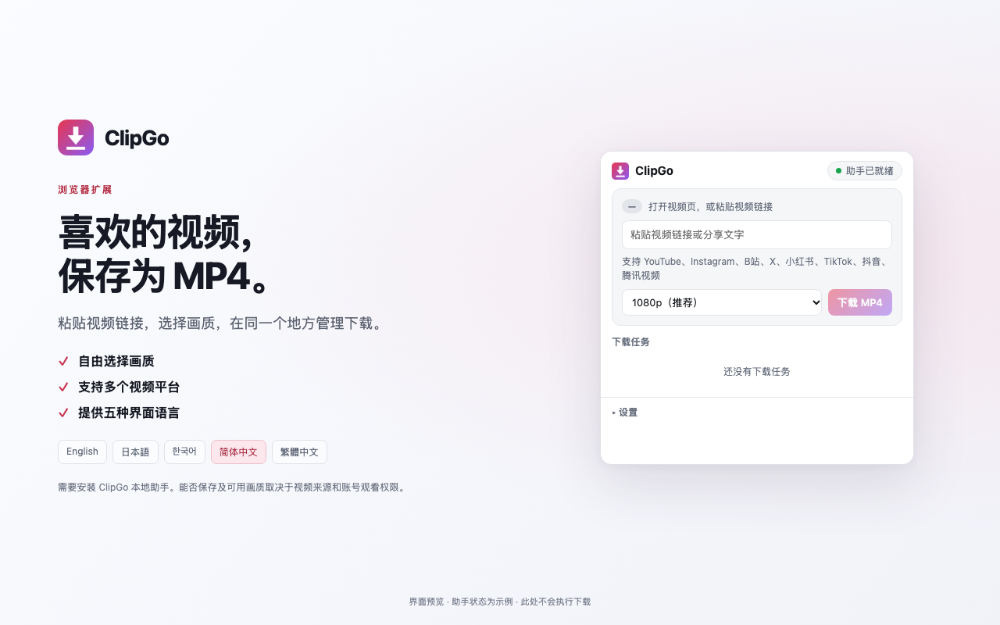
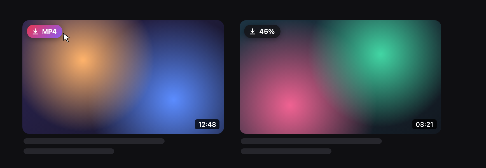
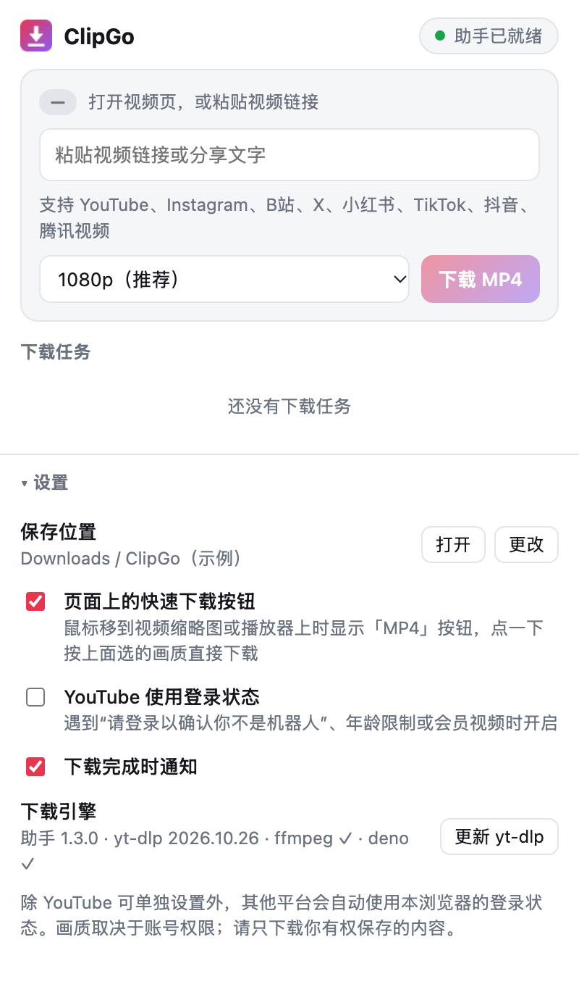

<div align="center">


# ClipGo

**鼠标一点，把在线视频保存为 MP4 的浏览器扩展**

支持 YouTube · Instagram · 哔哩哔哩 · X (Twitter) · 小红书 · TikTok · 抖音 · 腾讯视频

Microsoft Edge / Google Chrome · Windows 10/11 · macOS

[English](README.md) | **简体中文**

[下载 Windows 安装包](https://github.com/Wonvy/ClipGo/releases/latest) · [支持页面](https://wonvy.github.io/ClipGo/) · [问题反馈](https://github.com/Wonvy/ClipGo/issues) · [开发文档](docs/DEVELOPMENT.md)

</div>

<p align="center">
  
</p>

> [!NOTE]
> 请只保存你有权下载的内容。ClipGo 不绕过 DRM 和访问限制，实际可用画质取决于视频来源和你的账号观看权限。

---

## 功能亮点

- **一键下载**：鼠标移到视频缩略图或播放器上，点左上角的「⬇ MP4」就开始下载；全屏观看时按钮自动隐藏
- **兼容性好**：默认 1080p H.264 + AAC，任何播放器、手机和剪辑软件都能直接打开；也可选最高 4K
- **八个平台**：YouTube（含 Shorts）、Instagram（Reels / 帖子 / 快拍）、哔哩哔哩（BV / av / b23.tv / 分 P）、X、小红书、TikTok、抖音、腾讯视频
- **任务管理**：实时进度，可取消、重试、打开文件位置，完成后弹出系统通知
- **沿用登录状态**：自动使用对应网站在本浏览器的登录状态，不用手动导出 cookie（YouTube 需在设置中手动开启）
- **五种界面语言**：简体中文、繁体中文、English、日本語、한국어，跟随浏览器语言

<table>
  <tr>
    <td width="60%" valign="top">
      <b>页面上的快速下载按钮</b><br>
      <sub>悬停在缩略图上即可下载，按钮会显示下载进度（示意图）</sub><br><br>
      
    </td>
    <td width="40%" valign="top">
      <b>扩展弹窗</b><br>
      <sub>粘贴链接、选择画质、管理任务和设置</sub><br><br>
      
    </td>
  </tr>
</table>

---

## 目录

- [工作原理](#工作原理)
- [安装](#安装)
- [使用方法](#使用方法)
- [支持的网站与链接](#支持的网站与链接)
- [设置](#设置)
- [画质说明](#画质说明)
- [常见问题](#常见问题)
- [更新与卸载](#更新与卸载)
- [微信视频号工具（Windows）](#微信视频号工具windows)
- [项目结构](#项目结构)
- [致谢](#致谢)

---

## 工作原理

```
┌────────── 浏览器 (Edge / Chrome) ──────────┐          ┌──────── 本机：ClipGo 助手 ────────┐
│                                            │  Native  │                                   │
│  页面「MP4」按钮 ─┐                         │ Messaging│  clipgo_host.py                   │
│  右键菜单 ───────┼─► background.js ────────┼──────────┼─► yt-dlp  下载视频和音频          │
│  扩展弹窗 ───────┘   任务列表 / 进度         │          │   ffmpeg  合并为 MP4              │
│                                            │          │   deno    处理 YouTube 的 JS 验证  │
└────────────────────────────────────────────┘          └───────────────────────────────────┘
```

YouTube 等网站的高清视频是音视频分离的流，还带签名加密，纯浏览器扩展很难稳定下载。所以 ClipGo 分成两部分：

| 部分 | 作用 |
|---|---|
| **浏览器扩展** (`extension/`) | 界面：页面按钮、右键菜单、弹窗、任务列表 |
| **本地助手** (`host/`) | 实际下载：调用 [yt-dlp](https://github.com/yt-dlp/yt-dlp) 下载，用 FFmpeg 合成 MP4 |

两者通过浏览器的 [Native Messaging](https://developer.chrome.com/docs/extensions/develop/concepts/native-messaging) 通信。助手不常驻后台，只在下载时由浏览器启动。

---

## 安装

### Windows：离线安装包（推荐）

1. 从 [Releases](https://github.com/Wonvy/ClipGo/releases/latest) 下载 `ClipGo-1.3.0-Windows-x64-Setup.exe`（已从 Chrome / Edge 商店安装扩展的用户，请下载 `ClipGo-1.3.0-Chrome-Edge-Windows-x64-Setup.exe`）
2. 双击运行，选择语言并安装。安装包已内置 Python、yt-dlp、FFmpeg、FFprobe 和 Deno，**不需要管理员权限，也不需要联网下载组件**
3. 安装完成后会打开安装助手，按提示在 Chrome 或 Edge 中开启「开发者模式」并加载扩展文件夹
4. 打开 ClipGo，右上角显示 **「● 助手已就绪」** 即完成。已打开的视频页面需要刷新一次

- 程序安装在 `%LOCALAPPDATA%\ClipGo`，请保留该目录
- 可以从开始菜单的 **ClipGo Setup Guide** 再次打开安装助手
- 安装包目前未签名，可用 Release 页面提供的 SHA-256 校验

### macOS

打开「终端」运行（路径换成你放 ClipGo 的位置）：

```bash
bash ~/Downloads/ClipGo/host/install-mac.sh
```

- 安装位置：`~/Library/Application Support/ClipGo`，会联网下载约 150 MB 组件（yt-dlp、FFmpeg、Deno）
- 使用系统自带的 Python 3；如提示缺少，先运行 `xcode-select --install`
- 支持 Apple 芯片 (arm64) 和 Intel (x86_64)

装好助手后，按下面的[加载浏览器扩展](#加载浏览器扩展)操作。

### 从源码安装（Windows / macOS）

```bash
git clone https://github.com/Wonvy/ClipGo.git
```

然后安装本地助手：

- **Windows**：双击 `host\install-windows.bat`，看到「安装完成」后关闭窗口。会自带一个仅供助手使用的嵌入式 Python，不影响系统
- **macOS**：运行 `bash host/install-mac.sh`

#### 加载浏览器扩展

1. 打开扩展管理页：Edge 输入 `edge://extensions`，Chrome 输入 `chrome://extensions`
2. 打开 **开发者模式**（Edge 在左侧栏，Chrome 在右上角）
3. 点 **加载解压缩的扩展 / 加载已解压的扩展程序**，选择 ClipGo 里的 **`extension`** 文件夹
4. 确认扩展 ID 是 `mnhnajpalaecohikjibocdeamfmnpena`
5. 点工具栏的拼图图标，把 ClipGo 固定到工具栏

> [!TIP]
> 扩展 ID 由 `manifest.json` 里的 `key` 固定，所以每台电脑、每个浏览器的 ID 都一样。助手只接受这个 ID（以及商店版本 ID）的连接。

<details>
<summary>自己构建 Windows 安装包</summary>

```powershell
powershell -ExecutionPolicy Bypass -File packaging/windows/build.ps1
```

- 需要 [NSIS](https://nsis.sourceforge.io/)；运行时组件的版本和 SHA256 固定在 `packaging/windows/runtime-lock.json`
- 产物位于 `dist/`，不包含本机配置、Cookie 或下载记录
- 加 `-LocalSetup` 参数会生成 `ClipGo-1.3.0-Local-Windows-x64-Setup.exe`，不覆盖商店配套的助手安装包

</details>

---

## 使用方法

### 方式一：页面上的快速下载按钮

把鼠标移到视频**缩略图**或**正在播放的播放器**上，左上角会出现 **「⬇ MP4」** 按钮，点一下即按默认画质开始下载。全屏观看视频时按钮不会显示。

| 按钮显示 | 含义 |
|---|---|
| `⬇ MP4` | 点击开始下载 |
| `启动中…` → `✓ 已开始` | 已交给本地助手 |
| `45%` / `合并中…` | 这个视频正在下载 |
| `已下载 · 再下` | 已下载过，可以再下一次 |
| `失败` + 底部提示 | 查看提示中的原因 |

### 方式二：扩展弹窗

1. 在视频页点工具栏上的 ClipGo 图标，链接会自动填好；也可以粘贴视频链接或包含链接的分享文案
2. 选择画质，点 **「下载 MP4」**
3. 下方 **下载任务** 列表显示进度，可以 **取消**、**重试**、**打开位置**

### 方式三：右键菜单

- 在视频**链接**上右键 →「用 ClipGo 下载这个视频 (MP4)」（Instagram 信息流可在帖子时间戳上右键）
- 在视频**页面**上右键 →「用 ClipGo 下载当前视频 (MP4)」

### 保存位置

默认保存到 **`下载/ClipGo`**（`~/Downloads/ClipGo`），文件名为 `视频标题 [视频ID].mp4`，可在设置中更改。

---

## 支持的网站与链接

| 网站 | 支持的链接与范围 |
|---|---|
| YouTube | 首页、搜索、频道页、推荐、Shorts、播放页、悬停预览 |
| Instagram | 信息流视频帖子、个人主页网格、Reels、快拍 |
| 哔哩哔哩 | `bilibili.com/video/BV…`、`/video/av…`（含手机版）、`b23.tv` 短链接；分 P 视频保留 `?p=2` 等参数只下载所选 P。不支持番剧、直播、合集批量下载 |
| X (Twitter) | `x.com/用户名/status/ID` 及对应 `twitter.com` 链接；保留 `/video/2` 等附件序号 |
| 小红书 | `/explore/笔记ID`、`/discovery/item/笔记ID`、`xhslink.com` 短链接；请保留完整分享链接中的 `xsec_token`。图文笔记不是视频 |
| TikTok | `/@用户名/video/ID`、`vm.tiktok.com`、`vt.tiktok.com`、`tiktok.com/t/短码`；不下载主页、合集或直播 |
| 抖音 | `/video/ID`、页面中的 `modal_id`、`v.douyin.com` 短链接；不下载整个信息流或直播 |
| 腾讯视频 | `v.qq.com/x/page/ID.html`、`/x/cover/专辑ID/视频ID.html`；只处理单个视频或单集 |

<details>
<summary>抖音取源说明</summary>

粘贴抖音 `/video/ID` 链接或重试旧任务时，无需先手动打开播放。没有可用的网页视频信息时，扩展会在后台新建一个静音标签页打开目标视频，不弹窗、不切走当前标签页，最多等待约 12 秒取得播放地址后自动关闭。如果你接管该标签页或导航到其他页面，扩展会保留它。任务历史只保存视频页链接，不保存临时播放地址。「准备中」阶段可以随时取消。

</details>

---

## 设置

点开 ClipGo 弹窗，展开底部的 **设置**：

| 设置 | 说明 | 默认 |
|---|---|---|
| 保存位置 | 点「更改」弹出系统文件夹选择框 | `下载/ClipGo` |
| 页面上的快速下载按钮 | 在缩略图和播放器上显示「MP4」按钮 | 开 |
| YouTube 使用登录状态 | 用于年龄限制、会员视频，或遇到「确认你不是机器人」时 | 关 |
| 下载完成时通知 | 完成后弹出系统通知，点击可定位文件 | 开 |
| 更新 yt-dlp | 网站改版导致下载失败时使用 | — |

弹窗中选择的画质会被记住，也是页面按钮和右键菜单的默认画质。

---

## 画质说明

| 选项 | 编码 | 说明 |
|---|---|---|
| **1080p（推荐，默认）** | H.264 + AAC | 兼容性最好：QuickTime、Windows 播放器、手机、剪映、Premiere 都能直接打开 |
| 最高画质 (4K) | AV1 / VP9 + AAC | 最高 4K/8K。较老的电脑、QuickTime 可能无法播放，建议用 VLC 或浏览器 |
| 720p / 480p / 360p | H.264 + AAC | 文件更小 |

视频本身达不到所选分辨率时，会自动下载可用的最高画质。Instagram 通常只有一种画质。哔哩哔哩等网站的画质取决于账号权限，选择更高画质不会获得账号原本没有的观看权限。

---

## 常见问题

<details>
<summary><b>显示「未连接助手」/「未检测到 ClipGo 本地助手」</b></summary>

没有安装助手，或安装后没有重新加载扩展。重新运行安装程序，然后在扩展管理页点 ClipGo 的刷新按钮。
</details>

<details>
<summary><b>「本地助手拒绝了此扩展（扩展 ID 不匹配）」</b></summary>

扩展 ID 不是 `mnhnajpalaecohikjibocdeamfmnpena`。确认 `manifest.json` 里的 `key` 字段没有被删除或修改。
</details>

<details>
<summary><b>提示需要登录（Instagram / 哔哩哔哩 / X / 小红书 / TikTok / 抖音）</b></summary>

先在**同一个浏览器**里登录对应网站，确认账号能正常播放该视频后重试。ClipGo 会把登录 cookie 写进临时文件交给助手，下载结束后立即删除。小红书请重新复制完整分享链接；请求过于频繁（如哔哩哔哩 412 / 429）时请稍后再试。
</details>

<details>
<summary><b>腾讯视频提示没有权限或视频受到加密保护</b></summary>

确认当前账号能播放该视频。ClipGo 会检查返回的视频是否只是试看片段，检测到时会报错而不是保存不完整的视频。DRM 和未知加密方式不在支持范围内，登录也不保证所有会员视频都能下载。
</details>

<details>
<summary><b>YouTube 提示「请登录以确认你不是机器人」，或突然全部失败</b></summary>

- 在同一浏览器登录 YouTube，并在设置中打开 **「YouTube 使用登录状态」**
- 全部失败通常是 YouTube 改版，在设置里点 **「更新 yt-dlp」**
</details>

<details>
<summary><b>页面上没有出现「MP4」按钮</b></summary>

- 扩展更新或重新加载后，已打开的页面需要**刷新一次**
- 检查设置里的 **「页面上的快速下载按钮」** 是否打开
- 按钮只在足够大的缩略图（宽 100px 以上）和播放器上出现，全屏时会自动隐藏
</details>

<details>
<summary><b>下载很慢或超时</b></summary>

助手使用系统网络设置。如果通过代理访问视频网站，请确认是系统级代理或开启了 TUN 模式，而不只是浏览器代理。
</details>

<details>
<summary><b>Windows 杀毒软件报警 / macOS 提示组件已损坏</b></summary>

- yt-dlp.exe 由 PyInstaller 打包，偶尔会被误报，来源为 yt-dlp 官方 GitHub 发布页
- macOS 提示「Python.framework 已损坏」是旧版安装脚本的问题，重新运行 `install-mac.sh` 即可
</details>

<details>
<summary><b>怎么排查问题</b></summary>

查看助手日志 `host.log`：

- Windows：`%LOCALAPPDATA%\ClipGo\host.log`
- macOS：`~/Library/Application Support/ClipGo/host.log`
</details>

---

## 更新与卸载

**更新**：下载新版安装包运行，或 `git pull` 后重新运行安装脚本（会同时更新 yt-dlp），然后在扩展管理页刷新 ClipGo，并刷新已打开的视频页面。更新前请结束下载并关闭浏览器。

**只更新 yt-dlp**：在扩展设置中点「更新 yt-dlp」。

**卸载**：

- Windows 安装包：在「设置 → 应用 → 已安装的应用」中卸载 ClipGo
- Windows 源码安装：双击 `host\uninstall-windows.bat`
- macOS：`bash host/uninstall-mac.sh`
- 最后在扩展管理页移除 ClipGo

卸载不会删除已下载的视频。

---

## 微信视频号工具（Windows）

[`tools/wechat_channels`](tools/wechat_channels/README.md) 是一个独立的 Windows 桌面工具（实验版），可以读取微信主界面和独立播放窗口中已加载的视频号视频，并下载为 MP4：

- HTML 卡片界面，支持内置播放、自动同步、搜索、下载与 MP4 校验
- 默认读取方式无需代理或证书；也可在设置中开启微信页面内的下载按钮
- 已在 Windows 微信 4.1.15.56 上验证，其他版本可能需要适配

详见 [视频号工具说明](tools/wechat_channels/README.md)。

---

## 项目结构

```
ClipGo/
├── extension/          浏览器扩展（Manifest V3，Edge / Chrome 通用）
│   ├── manifest.json   扩展配置（含固定 ID 用的 key）
│   ├── background.js   后台：任务管理、与助手通信、右键菜单、通知
│   ├── content.js      页面脚本：缩略图 / 播放器上的「MP4」按钮
│   ├── common.js       共用：链接识别、画质选项、默认设置
│   ├── douyin-*.js     抖音视频信息解析
│   ├── popup.*         工具栏弹窗
│   └── _locales/       五种界面语言
├── host/               本地助手（clipgo_host.py）与安装 / 卸载脚本
├── i18n/               界面文案源文件
├── packaging/          Windows / macOS / 视频号安装包构建脚本
├── store/              商店上架材料与截图预览
├── tools/              助手调试工具、微信视频号工具
├── tests/              回归测试
└── docs/               开发文档与 README 图片
```

运行测试：

```bash
node --test tests/*.test.js
```

参与开发请阅读 **[开发文档](docs/DEVELOPMENT.md)**。

---

## 致谢

- [yt-dlp](https://github.com/yt-dlp/yt-dlp)：视频下载引擎
- [FFmpeg](https://ffmpeg.org/)：音视频合并（Windows 版来自 [yt-dlp/FFmpeg-Builds](https://github.com/yt-dlp/FFmpeg-Builds)，macOS 版来自 [martin-riedl.de](https://ffmpeg.martin-riedl.de/)）
- [Deno](https://deno.com/)：yt-dlp 处理 YouTube 时需要的 JavaScript 运行时

第三方许可证见 [`packaging/windows/THIRD-PARTY-NOTICES.txt`](packaging/windows/THIRD-PARTY-NOTICES.txt)。隐私政策：[wonvy.github.io/ClipGo/privacy-policy.html](https://wonvy.github.io/ClipGo/privacy-policy.html)。
